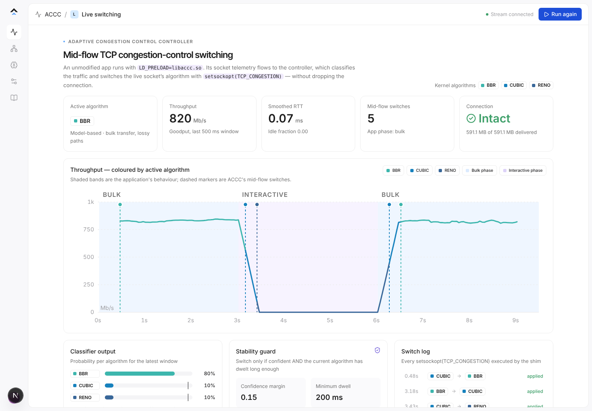

# ACCC — Adaptive Congestion Control Controller

Application-aware, **mid-flow** switching of TCP congestion control algorithms
(CUBIC / BBR / Reno / Vegas) per socket, using socket-level telemetry, an ML
classifier and a stability guard. No kernel patch, no application changes.

Full design: [`docs/IMPLEMENTATION_PLAN.md`](docs/IMPLEMENTATION_PLAN.md) · Beginner-friendly walkthrough: [`docs/EXPLAINED.md`](docs/EXPLAINED.md)

## Architecture (Figure 1)

```
 app (unmodified) ──LD_PRELOAD──► libaccc.so (C shim)        ──setsockopt(TCP_CONGESTION)──► kernel TCP
                                    │ TCP_INFO every 50 ms ▲ switch command
                                    ▼                      │
              accc daemon: features (sliding window) → classifier → stability guard
```

## Progress

| Phase | Component | Status |
|-------|-----------|--------|
| P0 | Plan, repo layout, packaging | ✅ done |
| P1 | Stability guard: confidence margin 0.15 + dwell time 200 ms (ref. 105) | ✅ done, unit-tested |
| P2 | Telemetry sample + 14-feature sliding-window extractor (ref. 103) | ✅ done, unit-tested |
| P3 | LD_PRELOAD C shim: socket hooks, TCP_INFO telemetry, setsockopt actuator (ref. 106/107) | ✅ working |
| P4 | Controller daemon (registry, decision loop, actuation) | ✅ working (rule-based policy as placeholder) |
| UI | Live dashboard (Next.js + SSE backend) | ✅ working |
| P5 | Training data generation + Random Forest classifier (ref. 104) | ⏳ next |
| P6 | eBPF telemetry collector (ref. 102) | ⏳ planned |
| P7 | Benchmarks: static CC vs. ACCC (goodput, tail latency) | ⏳ planned |

## Live demo

```bash
pip install -e .        # numpy, scikit-learn, joblib
make shim               # builds shim/libaccc.so
make demo               # runs demo/live_switch.py
```

The demo runs an unmodified Python TCP client whose behaviour changes
**bulk → interactive → bulk** on a single connection. ACCC watches its
telemetry and switches the socket's congestion control while it is running:

```
[ 0.03s] REGISTER  fd=3 127.0.0.1:53230 -> 127.0.0.1:39019 cc=cubic
[ 0.03s] ===== application phase: BULK =====
[ 0.48s] cc=cubic  tput=   815.6 Mb/s idle=0.00  SWITCH -> bbr    (gap 0.700)
[ 0.48s] ACK       setsockopt(TCP_CONGESTION, bbr) ok=True
[ 3.03s] ===== application phase: INTERACTIVE =====
[ 3.38s] cc=cubic  tput=   184.1 Mb/s idle=0.56  SWITCH -> reno   (gap 0.700)
[ 3.54s] cc=reno   tput=     0.0 Mb/s idle=0.67  keep             (already-active)
[ 6.03s] ===== application phase: BULK =====
[ 6.53s] cc=cubic  tput=   836.5 Mb/s idle=0.00  SWITCH -> bbr    (gap 0.700)

--- summary ---
switches performed mid-flow : 5 (cubic -> bbr -> cubic -> reno -> cubic -> bbr)
bytes sent / received       : 613158816 / 613158816
connection survived intact  : True
```

Vegas is used for the interactive class when the kernel provides it
(`tcp_vegas` module); the dev machine only has `reno bbr cubic`.

## Live dashboard

A Next.js dashboard (UI components and design tokens taken from
[magpie](https://github.com/akkki007/magpie)) streams the controller's
decisions live: throughput coloured by the active algorithm, application-phase
bands, switch markers, classifier probabilities, stability-guard state, the
switch log and the 14-feature vector.



```bash
make shim
python3 -m demo.server            # terminal 1: backend on :8765 (SSE)
cd dashboard && bun install && bun run dev   # terminal 2: UI on http://localhost:3000
```

Press **Run demo**. The backend (`demo/server.py`, stdlib asyncio) launches the
scenario and streams events over Server-Sent Events; Next.js proxies `/api/*`
to it, so the browser talks to one origin.

## Tests

```bash
make test
```

## Notes / limitations (current state)

- The decision policy is a transparent **rule-based placeholder**; the trained
  Random Forest replaces it in P5 behind the same interface.
- Telemetry currently comes from the shim (`getsockopt(TCP_INFO)`); the eBPF
  collector is the next telemetry backend.
- Network-impairment experiments (tc-netem) need a full Linux host/VM.
