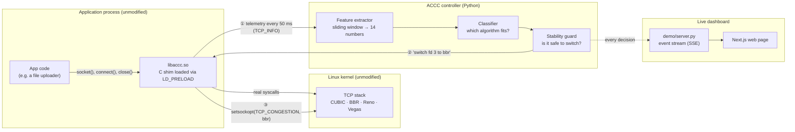
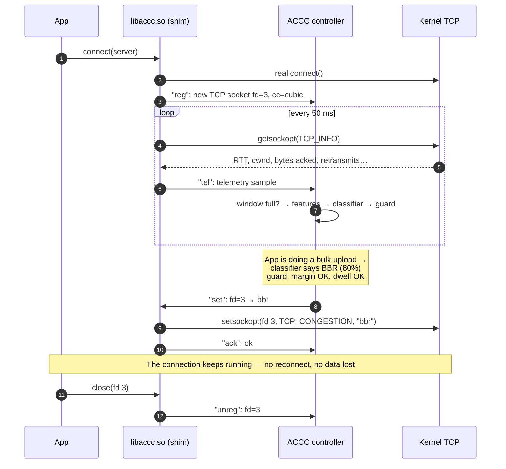
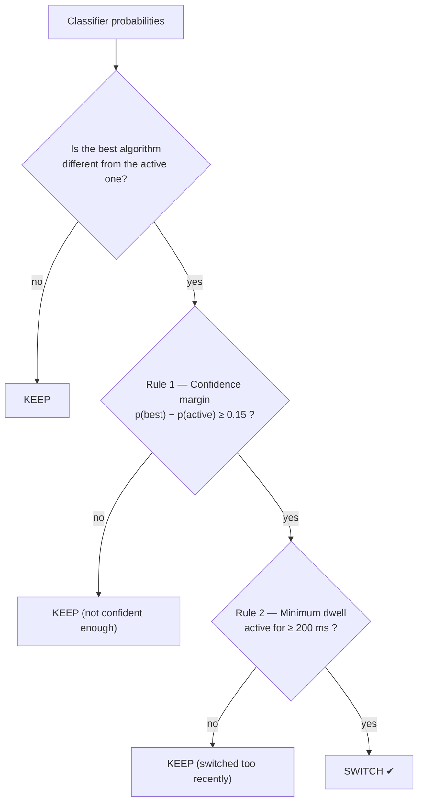
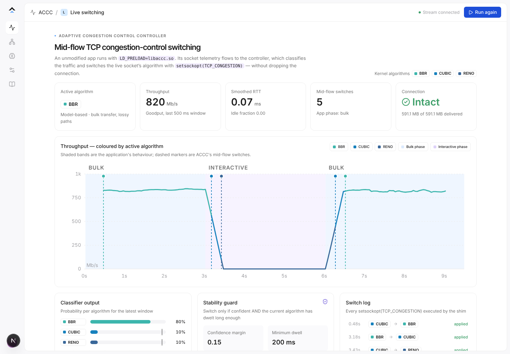
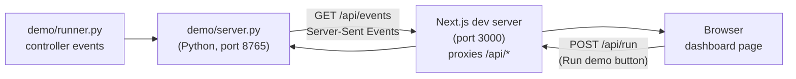

# ACCC Explained — in plain words

This document explains the whole project from scratch: what problem it solves,
how each piece works, how the pieces talk to each other, and how to run it.
No prior networking knowledge is assumed.

---

## 1. The problem in one minute

When your computer sends data over the internet with **TCP**, it cannot just
blast data as fast as possible — the network would overflow and packets would
be lost. So TCP uses a **congestion control (CC) algorithm** that decides
*how fast to send*. Think of it as the "driving style" of a connection.

Linux ships several driving styles:

| Algorithm | Driving style | Best for |
|-----------|---------------|----------|
| **CUBIC** | Speeds up aggressively, backs off when it sees loss. Linux default. | Fast, wired links |
| **BBR** | Measures the road (bandwidth and delay) and drives at that speed. | Big downloads, video, lossy links |
| **Reno** | The classic, simple, careful style. | Light traffic |
| **Vegas** | Watches delay and slows down before traffic jams form. | Short, interactive request/response |

**The catch:** today the algorithm is chosen **once** — either for the whole
machine (`net.ipv4.tcp_congestion_control`) or when the connection opens — and
it **never changes**. But real applications change behaviour while running: a
video call app might upload a big file and then go back to small chat messages
on the same connection. One fixed style cannot be best for both.

**Our idea (ACCC):** watch every connection while it runs, recognise what kind
of traffic it currently carries, and **switch its algorithm on the fly** —
without breaking the connection, without changing the kernel, and without
changing the application.

---

## 2. The big picture



In one sentence: **the shim watches the socket, the controller decides, the
shim applies the decision, and the dashboard shows it all live.**

---

## 3. A connection's journey, step by step



---

## 4. The components, one by one

The numbers in brackets (ref. 10x) are the reference numbers from Figure 1 of
the patent proposal.

### 4.1 The shim — `shim/libaccc.c` (ref. 106, 107)

**What it is:** a small C library that gets loaded *into* the application.

**How it gets in without changing the app:** Linux has a feature called
`LD_PRELOAD`. If you start a program like this:

```bash
LD_PRELOAD=./shim/libaccc.so  ./my_app
```

then our library is loaded first, and our versions of `socket()`,
`connect()`, `accept()` and `close()` are used instead of the normal ones.
Each of our versions simply calls the real function and additionally takes a
note: "a new TCP connection exists" or "this one is gone".

**What it does:**

1. **Tracks TCP sockets.** Only IPv4/IPv6 TCP sockets — everything else is ignored.
2. **Registers** each connected socket with the controller (sends `reg`).
3. **Samples telemetry** every 50 ms with `getsockopt(TCP_INFO)` — a standard
   kernel call that reports RTT, congestion window, bytes acknowledged,
   retransmissions, etc. — and sends it to the controller (`tel`).
4. **Executes switches.** When the controller says `set fd=3 cc=bbr`, it calls
   `setsockopt(fd, IPPROTO_TCP, TCP_CONGESTION, "bbr")`. Linux supports
   changing this on a live socket, so the connection continues normally.

**Safety rules built in:**

- **Fail-open:** if the controller is not running, the app works exactly as
  normal; the shim just retries connecting once per second.
- **No races on closed sockets:** a lock makes sure we never touch a socket
  number that the app has just closed (and that might be reused).
- **Fork-safe:** if the app forks a child process, the child starts with a
  clean state instead of sharing the parent's channel.

**Why C:** this code lives inside *someone else's* program, so it must be tiny,
have no runtime of its own, and survive `fork()`. C is the natural fit.

### 4.2 The message protocol (shim ⇄ controller)

They talk over a **Unix domain socket** (a local-only socket, like a file on
disk), one JSON message per line:

| Direction | Message | Meaning |
|-----------|---------|---------|
| shim → controller | `{"t":"reg", "pid", "fd", "src", "dst", "cc"}` | New TCP connection |
| shim → controller | `{"t":"tel", "pid", "fd", "ts", "srtt_us", "snd_cwnd", "bytes_acked", ...}` | One telemetry sample |
| shim → controller | `{"t":"unreg", "pid", "fd"}` | Connection closed |
| controller → shim | `{"t":"set", "fd", "cc"}` | Please switch this socket |
| shim → controller | `{"t":"ack", "fd", "cc", "ok", "err"}` | Switch done (or failed, with reason) |

### 4.3 Telemetry sample — `accc/telemetry/sample.py` (ref. 102)

A simple data record of one `TCP_INFO` reading:

| Field | Meaning in plain words |
|-------|------------------------|
| `srtt_us` | Smoothed round-trip time: how long a packet takes there and back |
| `rttvar_us` | How much that round-trip time jumps around |
| `min_rtt_us` | The fastest round trip seen — the "empty road" delay |
| `snd_cwnd` | Congestion window: how many packets may be in flight at once |
| `total_retrans` | Packets that had to be re-sent (a sign of loss) |
| `segs_out` | Packets sent so far |
| `bytes_acked` | Bytes the other side confirmed receiving |
| `app_limited` | The app itself is not giving TCP enough data to send |

> The patent's preferred telemetry source is an **eBPF** program inside the
> kernel. That is planned (phase P6). Today the shim reads the same fields with
> `getsockopt(TCP_INFO)`, which works on any Linux without extra tooling.

### 4.4 Feature extractor — `accc/features.py` (ref. 103)

One sample is noisy. So for each socket we keep a **sliding window** of the
last 10 samples (10 × 50 ms = half a second) and summarise it into **14
numbers** — the "feature vector". This is what the classifier looks at.

| Feature | What it tells us |
|---------|------------------|
| `rtt_mean_ms`, `rtt_std_ms`, `min_rtt_ms`, `rttvar_mean_ms` | How slow and how jittery the path is |
| `rtt_inflation` | Current RTT ÷ minimum RTT. Above 1 = packets are waiting in queues |
| `loss_ratio` | Fraction of packets that were re-sent |
| `cwnd_mean`, `cwnd_slope` | How big the sending window is and whether it's growing |
| `tput_mbps`, `tput_trend` | Throughput (megabits/s) and whether it's rising or falling |
| `burst_cv` | How "bursty" the sending is (steady stream vs. on/off) |
| `idle_frac` | Fraction of the window with nothing sent — high for chatty apps |
| `app_limited_frac` | How often the app, not the network, was the bottleneck |
| `log_flow_bytes` | Total bytes so far (log scale) — a hint of flow size |

```
samples:  s1  s2  s3  s4  s5  s6  s7  s8  s9  s10   ← newest
          └──────────────── window ───────────────┘
                              │
                              ▼
          [rtt_mean, rtt_std, …, idle_frac, …]   (14 numbers)
```

### 4.5 Classifier / policy — `accc/policy.py` (ref. 104)

Takes the 14 numbers and answers: **"how well does each algorithm suit this
traffic right now?"** as probabilities, e.g. `{bbr: 0.8, cubic: 0.1, reno: 0.1}`.

- **Today:** a simple, transparent **rule-based policy** stands in:
  - steady high throughput, never idle → **BBR**
  - mostly idle / small messages → **Vegas** (or **Reno** if the kernel has no Vegas)
  - otherwise → **CUBIC**
- **Next (phase P5):** a **Random Forest** model trained with scikit-learn on
  real measurements. It plugs into the exact same interface
  (`predict_proba(features) → probabilities`), so nothing else changes.

### 4.6 Stability guard — `accc/guard.py` (ref. 105)

A classifier can flip its mind every half-second on borderline traffic.
Switching that often would hurt performance. The guard allows a switch **only
if both rules pass**:



- **Margin (default 0.15):** the new choice must be clearly better, not just
  slightly. Prevents ping-ponging on ties.
- **Dwell time (default 200 ms):** after a switch the new algorithm gets time
  to settle before another switch is allowed. Puts a hard cap on how often
  switches can happen.
- It also refuses algorithms the kernel doesn't have.

Unit tests prove that alternating near-tie predictions cause **zero** switches,
and that even adversarial input can't switch more than once per dwell period.

### 4.7 Controller daemon — `accc/daemon.py`

The "brain" process that ties it together:

1. Listens on the Unix socket for shims.
2. Keeps a **registry** of every live flow: `(pid, fd) → window, current cc, last switch time`.
3. On each telemetry sample: push into the window → features → policy → guard.
4. If the guard says switch: sends `set` and marks the flow "pending" until the `ack` arrives.
5. Reports every event (`register`, `decision`, `ack`, `unregister`) to an
   `on_event` callback — used by the terminal demo and the dashboard.

It's written with Python **asyncio**, so one process handles many apps and
sockets at once.

---

## 5. The demo

### 5.1 The demo application — `demo/workload.py`

A plain Python TCP client with **no ACCC code in it**. On **one** connection it
behaves in three phases:

| Time | Phase | Behaviour |
|------|-------|-----------|
| 0–3 s | **Bulk** | Sends 64 KB chunks as fast as it can (like a file upload) |
| 3–6 s | **Interactive** | Sends a 200-byte message every 150 ms (like chat) |
| 6–9 s | **Bulk** | Back to the big upload |

### 5.2 The scenario runner — `demo/runner.py`

Starts everything needed for one demo run:

1. the **controller** (on a temporary Unix socket),
2. a **receiver** that counts every byte that arrives,
3. the **workload** process with `LD_PRELOAD=libaccc.so`,

and at the end checks **bytes sent == bytes received** to prove the
connection was never broken.

### 5.3 Terminal demo — `make demo`

Prints what happens, live:

```
[ 0.03s] REGISTER  fd=3 127.0.0.1:53230 -> 127.0.0.1:39019 cc=cubic
[ 0.48s] cc=cubic  tput=815.6 Mb/s idle=0.00  SWITCH -> bbr
[ 3.03s] ===== application phase: INTERACTIVE =====
[ 3.38s] cc=cubic  tput=184.1 Mb/s idle=0.56  SWITCH -> reno
[ 6.03s] ===== application phase: BULK =====
[ 6.53s] cc=cubic  tput=836.5 Mb/s idle=0.00  SWITCH -> bbr

switches performed mid-flow : 5 (cubic -> bbr -> cubic -> reno -> cubic -> bbr)
bytes sent / received       : 613158816 / 613158816
connection survived intact  : True
```

(The short stops at CUBIC happen while the window still contains a mix of the
old and new behaviour — the policy honestly reports "in between".)

---

## 6. The live dashboard



### 6.1 How the dashboard gets live data



- **`demo/server.py`** is a tiny web server (Python standard library only) with three endpoints:
  - `GET /api/status` — which algorithms the kernel has, guard settings, is a run active
  - `POST /api/run` — start a demo run
  - `GET /api/events` — a never-ending **Server-Sent Events** stream: each controller event is pushed as one `data: {...}` line the moment it happens
- **Next.js** forwards `/api/*` to the Python server so the browser only talks to one address.
- **`dashboard/lib/use-accc-stream.ts`** is a React hook that opens the stream and turns events into page state (batched once per animation frame so it stays smooth).

### 6.2 What each part of the page shows

| Panel | Shows |
|-------|-------|
| **Top bar** | Stream connected/offline, **Run demo** button |
| **Active algorithm** | Which CC the live socket uses right now |
| **Throughput / RTT** | Latest values from the feature window |
| **Mid-flow switches** | How many switches so far, current app phase |
| **Connection** | Live → then **Intact** with bytes delivered |
| **Throughput chart** | Line coloured by the active algorithm, shaded bands = app phase, dashed markers = switches |
| **Classifier output** | Probability bar per algorithm; the black tick shows what a challenger must beat (active + margin) |
| **Stability guard** | Margin, dwell time, live dwell progress bar, last verdict and its reason |
| **Switch log** | Every `setsockopt` the shim executed, with time and result |
| **Smoothed RTT chart** | Delay over time, same colouring |
| **Feature vector** | The 14 numbers the classifier is looking at right now |
| **Pipeline** | Figure 1 of the patent, as implemented |

### 6.3 Where the UI design comes from

The look and feel (colours, rail, top bar, cards, chips, legend, toasts) is
taken from [magpie](https://github.com/akkki007/magpie): `app/globals.css`,
`components/app/*`, `components/ui/*` were copied and adapted (ACCC navigation,
no login). The ACCC-specific pieces live in `dashboard/components/accc/`.

---

## 7. Folder map

```
tcp-congestion-control/
├── accc/                     Python package — the controller
│   ├── telemetry/sample.py   one TCP_INFO reading           (ref. 102)
│   ├── features.py           sliding window → 14 features   (ref. 103)
│   ├── policy.py             features → probabilities       (ref. 104, placeholder)
│   ├── guard.py              margin + dwell check           (ref. 105)
│   └── daemon.py             registry + decision loop
├── shim/
│   ├── libaccc.c             LD_PRELOAD shim                (ref. 106, 107)
│   └── Makefile
├── demo/
│   ├── workload.py           unmodified bulk→chat→bulk app  (ref. 100)
│   ├── runner.py             starts controller + receiver + app
│   ├── live_switch.py        terminal demo
│   └── server.py             SSE backend for the dashboard
├── dashboard/                Next.js live UI
│   ├── app/                  page, layout, global styles
│   ├── components/app/       shell, rail, top bar (from magpie)
│   ├── components/ui/        chips, charts, logo, toasts (from magpie)
│   ├── components/accc/      KPI cards, timeline chart, probability bars
│   └── lib/                  stream hook, types, helpers
├── tests/                    pytest unit tests (guard, features)
├── docs/
│   ├── IMPLEMENTATION_PLAN.md  technical plan and phases
│   ├── EXPLAINED.md            this file
│   └── images/                 screenshots
└── Makefile                  make shim | test | demo | backend | dashboard
```

---

## 8. How to run it

**Requirements:** Linux, Python 3.10+, gcc, and for the UI: Bun (or Node.js).

```bash
pip install -e .          # numpy, scikit-learn, joblib
make shim                 # build shim/libaccc.so
make test                 # run unit tests
make demo                 # terminal demo
```

Live dashboard (two terminals):

```bash
python3 -m demo.server                         # terminal 1 — backend on :8765
cd dashboard && bun install && bun run dev     # terminal 2 — open http://localhost:3000
```

Then click **Run demo**.

Using ACCC with *any* program works the same way the demo does — start the
program with the shim preloaded and point it at a running controller:

```bash
LD_PRELOAD=$PWD/shim/libaccc.so ACCC_SOCK=/path/to/accc.sock  some_program
```

> Today the controller is started by the demo runner. A standalone
> `accc` daemon command (listening on `/run/accc.sock` for any app) is a small
> next step and is not built yet.

Shim settings (environment variables):

| Variable | Default | Meaning |
|----------|---------|---------|
| `ACCC_SOCK` | `/run/accc.sock` | Where the controller listens |
| `ACCC_INTERVAL_MS` | `50` | Telemetry sampling interval |
| `ACCC_DEBUG` | unset | Print shim diagnostics to stderr |

---

## 9. How this maps to the patent claims

| Claim | Requirement | Where it is |
|-------|-------------|-------------|
| 1 | Telemetry collector + ML classifier + stability guard + mid-flow actuator | shim + `features.py` + `policy.py` + `guard.py` + shim `setsockopt` |
| 2 | Telemetry includes smoothed RTT, RTT variance, retransmissions, cwnd | `TelemetrySample` fields (eBPF version planned) |
| 3 | Random Forest / gradient-boosted trees trained offline | **Next phase (P5)** — rule-based placeholder today |
| 4 | Switch only with confidence margin **and** minimum dwell | `accc/guard.py` + unit tests |
| 5 | Actuator = LD_PRELOAD shim calling `setsockopt(TCP_CONGESTION)` | `shim/libaccc.c` |
| 6–7 | Switching without terminating or restarting the connection | Demo: bytes sent == bytes received after 5 switches |
| 8 | Kernel and application unmodified | Stock kernel; `demo/workload.py` has no ACCC code |

---

## 10. Status and what's next

| Phase | Item | Status |
|-------|------|--------|
| P0 | Plan, repo structure | ✅ |
| P1 | Stability guard | ✅ tested |
| P2 | Telemetry + feature extractor | ✅ tested |
| P3 | LD_PRELOAD shim | ✅ working |
| P4 | Controller daemon | ✅ working (rule-based policy) |
| UI | Live dashboard | ✅ working |
| P5 | Training data + Random Forest classifier | ⏳ next |
| P6 | eBPF telemetry collector | ⏳ planned |
| P7 | Benchmarks: fixed CC vs. ACCC (goodput, tail latency) under `tc-netem` | ⏳ planned |

**Known limitations today**

- Decisions come from simple rules, not yet a trained model.
- The demo runs over `localhost`; realistic delay/loss experiments need a
  Linux machine with `tc-netem` (not available in the dev container).
- `LD_PRELOAD` doesn't affect statically linked programs or Go programs (they
  bypass libc); the eBPF collector and a `pidfd_getfd`-based actuator are the
  planned answers.
- Vegas is used only if the kernel has the `tcp_vegas` module loaded.

---

## 11. Glossary

| Term | Meaning |
|------|---------|
| **TCP** | The protocol that delivers data reliably and in order between two computers |
| **Congestion control (CC)** | The algorithm deciding how fast a TCP connection sends |
| **RTT** | Round-trip time — how long a packet takes to go and an acknowledgement to come back |
| **cwnd** | Congestion window — how much unacknowledged data may be "in the air" |
| **Throughput / goodput** | Useful data delivered per second |
| **Socket / fd** | The program's handle for a connection (a small number, e.g. 3) |
| **LD_PRELOAD** | Linux feature to load a library into a program first, overriding functions |
| **setsockopt / getsockopt** | Standard calls to change / read a socket's settings |
| **TCP_INFO** | A `getsockopt` option returning the kernel's live TCP statistics |
| **eBPF** | Safe small programs that run inside the Linux kernel for observation |
| **Unix domain socket** | A local-only communication channel between processes |
| **SSE (Server-Sent Events)** | A simple way for a web server to push a live stream of messages to a browser |
| **Random Forest** | An ML model made of many decision trees that vote |
